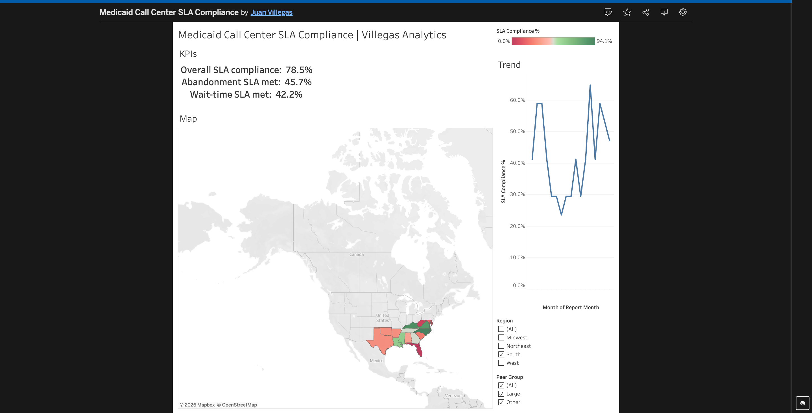

# Medicaid Access Monitor
### Contact Center Performance Intelligence | Villegas Analytics

**Which states left Medicaid callers waiting the longest during "unwinding," and what does that say about people's access to coverage?**

🔗 **Live dashboard:** https://medicaid-access-monitor.streamlit.app/
📊 **Tableau SLA dashboard:** https://public.tableau.com/app/profile/juan.villegas4381/viz/MedicaidCallCenterSLACompliance/Dashboard1

---

## Key findings (March 2023 – July 2024, 50 reporting states + DC)

- **Florida ranked 3rd worst of 50 reporting states** for call-center access, behind Missouri and Montana.
- Florida callers waited **about 31 minutes** on average: **2× the national average (14.4 min)** and **5× the other large states (6.3 min)**. Florida's wait was over 15 minutes in **all 17 months**.
- **37% of Florida callers hung up** before reaching anyone, about **13.4 million calls**, against 18.4% nationally.
- Florida handled **23% of all Medicaid call-center calls in the U.S.** and had the highest call load in the country (486.7 calls per 1,000 enrollees per month).
- Nationally, the **worst month was July 2023** (20.2-minute weighted wait, 22.6% hung up). Call volume rose and fell with renewals (correlation 0.94).
- **Recovery is possible:** several states cut waits by 30+ minutes from their peak (Maine 44 → 5.7, Idaho 56 → 18.7, Oklahoma 46 → 9.7).

## Recommendations (from the [findings memo](docs/findings_memo.md))

1. **Staff to the renewal calendar:** calls track renewals almost one-to-one, so peaks are predictable.
2. **Cut avoidable calls:** automatic renewals, clearer notices, self-service status checks.
3. **Stop losing callers in the queue:** virtual callback after 10 minutes.
4. **Manage to weekly targets:** wait under 15 minutes, abandonment under 15%.
5. **Learn from recovered states:** Maine, Oklahoma and Idaho cut waits by 30+ minutes.

## The story in brief

From 2023 to 2024, when the COVID-era continuous-enrollment rule ended, every state had to re-check the Medicaid eligibility of everyone enrolled. Millions of people called state call centers to renew their coverage. CMS published monthly call-center figures for every state. This project cleans those figures, proves the numbers are right, and turns them into reports, a dashboard and recommendations a Medicaid operations director could act on.

## What I built

| # | Deliverable | Where | Status |
|---|---|---|---|
| 1 | **Python cleaning pipeline:** tidy tables, 12 quality checks, exceptions log (417 entries), CAA vs PI reconciliation | [`python/clean_data.py`](python/clean_data.py), [`data/clean/`](data/clean/) | ✅ |
| 2 | **Data quality report** | [`docs/data_quality_report.md`](docs/data_quality_report.md) | ✅ |
| 3 | **Excel reporting engine:** Power Query (documented steps), Calc table with XLOOKUP, PivotTable with weighted calculated fields, PivotChart, region slicer, state scorecard with risk score, Florida spotlight, reconciliation tab | [`excel/Medicaid_Access_Reporting.xlsx`](excel/) | ✅ |
| 4 | **SQL query pack:** 19 DuckDB queries (GROUP BY, JOINs, CTEs, window functions RANK / LAG / ROW_NUMBER, CORR) | [`sql/`](sql/) | ✅ |
| 5 | **Interactive dashboard:** U.S. map, state ranking, Florida spotlight, state comparison, filters | [`dashboard/app.py`](dashboard/app.py) · [live](https://medicaid-access-monitor.streamlit.app/) | ✅ |
| 6 | **Findings memo** (2 pages, 5 recommendations) | [`docs/findings_memo.md`](docs/findings_memo.md) · [PDF](docs/findings_memo.pdf) | ✅ |
| 7 | **Rollout simulation** (12-week pilot plan, task tracker, weekly KPIs; **clearly labeled simulation**) | [`simulation/`](simulation/rollout_plan.md) | ✅ |
| 8 | **Executive briefing** (7 slides) | [`presentation/executive_briefing.pdf`](presentation/executive_briefing.pdf) | ✅ |
| 9 | **CX & SLA compliance module:** configurable service standards, 4 SLA queries (Q16–Q19, incl. miss streaks), Excel SLA tab, one-command refresh with a dated KPI report and 10 PASS/FAIL checks, Tableau dashboard | [`docs/sla_methodology.md`](docs/sla_methodology.md) · [`python/run_pipeline.py`](python/run_pipeline.py) · [Tableau](https://public.tableau.com/app/profile/juan.villegas4381/viz/MedicaidCallCenterSLACompliance/Dashboard1) | ✅ |
| 10 | **Learning log** (5 days, decisions and lessons) | [`learning-log/`](learning-log/LEARNING_LOG.md) | ✅ |

## CX & SLA compliance module (automated)

A customer-experience team doesn't only ask "how long was the wait?" They ask: **did we meet our standard, how often, and who keeps missing it?**

**Standards** (analyst-defined and illustrative, **not official CMS rules**; set in [`config/sla_config.json`](config/sla_config.json)): average wait **≤ 10 minutes** and abandonment **≤ 5%**. A state-month meets the SLA only if both are met.

| KPI (Mar 2023 – Jul 2024) | Result |
|---|---|
| State-months evaluated | 849 |
| Overall SLA compliance | **33.6%** |
| Wait-time SLA met | 64.7% |
| Abandonment SLA met | 34.7% (abandonment is the bigger problem) |
| States that missed 3+ months in a row | **43** |
| Florida | **met the SLA in 0 of 17 months** |

**One command refreshes everything:**

~~~
python python/run_pipeline.py

[1/5] Cleaning raw CMS files             867 state-months PASS
[2/5] Running SQL queries                19 results saved PASS
[3/5] Applying SLA standards             wait<=10 min, abandon<=5%
[4/5] Writing KPI report                 output/kpi_report_2026-11-17.csv
[5/5] Reconciliation checks              10/10 PASS
~~~

It writes a dated KPI report ([`output/`](output/)), a plain-English summary ([`output/sla_summary.md`](output/sla_summary.md)) and a run log ([`logs/pipeline_log.txt`](logs/pipeline_log.txt)). It stops with FAIL if any check breaks. The same SLA counts are rebuilt in Excel (`SLA_Compliance` tab), and the workbook's Reconciliation tab confirms them (10 of 10 PASS).

📊 **[Open the Tableau dashboard](https://public.tableau.com/app/profile/juan.villegas4381/viz/MedicaidCallCenterSLACompliance/Dashboard1)**: KPI strip, U.S. map by compliance, monthly trend and a watch list, with region and peer-group filters.

Method and limits: [`docs/sla_methodology.md`](docs/sla_methodology.md)

## How I made sure the numbers are right

- **Raw files are never edited.** Every change happens in code and is logged.
- **Control totals match across all three tools:**

| Check | Python | SQL | Excel |
|---|---|---|---|
| State-months | 867 | 867 | 867 |
| Total calls | 154,681,330 | 154,681,330 | 154,681,330 |
| Abandoned calls | 28,472,216 | 28,472,216 | 28,472,216 |

- **417 data issues logged, none hidden.** For example: South Dakota has no call center (excluded from rankings, not treated as zero); Rhode Island's call volume fell 86% in one month (a counting change, flagged); 79 months show a 0-minute wait (whole-minute rounding).
- **Two CMS copies reconciled:** 89 values differ between the official CAA release and the later-revised PI dataset (mostly Nebraska and Hawaii). The CAA values are used and every difference is listed.

## Data

Real, public CMS data:
- **Medicaid and CHIP CAA Reporting Metrics** (October 2024 release): the main source.
- **State Medicaid and CHIP Applications, Eligibility Determinations, and Enrollment Data** (Performance Indicator dataset, March 2026 release): enrollment, applications and reconciliation.

Details: [`docs/project_charter.md`](docs/project_charter.md) · [`docs/data_sources.md`](docs/data_sources.md) · [`docs/data_dictionary.md`](docs/data_dictionary.md)

## Run it yourself

~~~
pip install -r requirements.txt
python python/clean_data.py      # rebuild the clean tables + exceptions log
python python/run_sql.py         # run the 19 SQL queries
python python/run_pipeline.py    # or: the whole refresh in one command (clean + SQL + SLA report + checks)
streamlit run dashboard/app.py   # open the dashboard locally
~~~

## Repository structure

~~~
data/raw/          untouched original CMS downloads (never edited)
data/clean/        clean tables, exceptions log, reconciliation
data/lookup/       state regions and peer groups
docs/              charter, data sources, data dictionary, quality report
excel/             Excel reporting workbook
sql/               DuckDB query pack + results
python/            cleaning pipeline, SQL runner and one-command pipeline
config/            SLA standards (change and re-run)
output/            dated KPI report + SLA summary (written by the pipeline)
logs/              pipeline run log
dashboard/         Streamlit app
simulation/        clearly labeled rollout simulation (plan, tracker, weekly KPIs)
presentation/      7-slide executive briefing (PDF)
learning-log/      what I learned and why I made each decision
~~~

## Honesty notes

- All results come from real public CMS data. The rollout figures in `simulation/` are a **clearly labeled simulation**.
- States define "call center" differently, so comparisons show broad patterns, not exact rankings.
- Findings show patterns, not causes.
- Built with AI assistance for code and drafting; every data check, reconciliation and finding was verified by me.
- Independent portfolio project, not affiliated with CMS or any state.

---
Built by **Juan Villegas** · [github.com/villegasjv55](https://github.com/villegasjv55)
